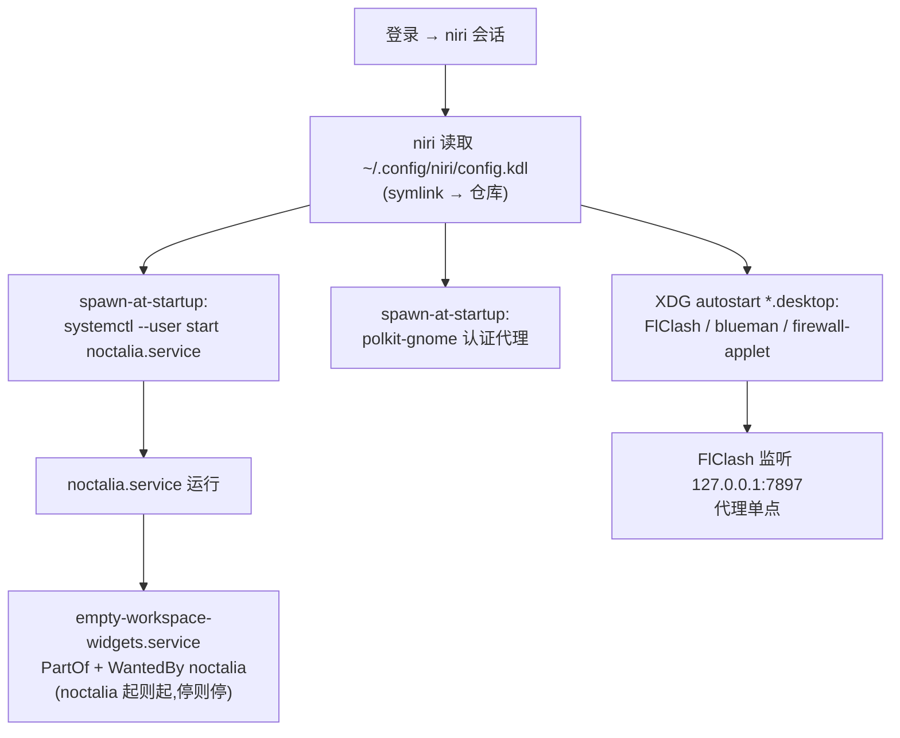

# 架构

## 技术栈(全部来自官方 extra 仓库,见 manifest `[packages]`)

| 组件 | 版本(本机) | 角色 |
|---|---|---|
| EndeavourOS | — | 基础发行版 |
| niri | 26.04-1 | Wayland 滚动平铺 compositor |
| noctalia | 5.5.0-1 | niri 配套 shell(锁屏/通知接管/小组件/主题) |
| kitty | — | GPU 终端 |
| oh-my-zsh | 固定 commit `17a2b4c` | shell 框架(bootstrap 克隆,不入库) |
| spaceship-prompt | `0676854` (v4.22.6) | zsh 主题 |
| fcitx5 + fcitx5-rime | — | 输入法(雾凇拼音 rime_frost) |

## 启动链

- niri 自身由显示管理器拉起,不在托管服务内。
- 环境变量两级:niri `environment {}` 块(config.kdl:24,仅 Wayland 子进程)+ `~/.config/environment.d/`(systemd 用户管理器,60-fcitx5/70-browser/90-proxy)。

## 用户服务(5 个,unit 文件均入库)

| 服务 | 用途 | 启用方式 |
|---|---|---|
| `noctalia.service` | noctalia shell | **不 enable**,由 niri `spawn-at-startup` 拉起(daemon-reload only) |
| `empty-workspace-widgets.service` | 空工作区才显示桌面小组件(PartOf/WantedBy noctalia) | `enable --now`(deploy) |
| `sshx-agent.service` | sshx 共享会话代理 | `enable --now`(deploy) |
| `honor-sleep-test-guard.service` | 睡眠测试守护 | `enable --now`(deploy) |
| `deepseek-harness.service` | deepseek 任务 harness | 不 enable,按需启动(daemon-reload only) |

## 代理体系

单点:FlClash 常驻 `127.0.0.1:7897`(XDG autostart 拉起)。三处消费:

1. `~/.config/environment.d/90-proxy.conf` — systemd 用户级 `HTTP(S)_PROXY/ALL_PROXY`,git/http 默认走代理;
2. `~/.config/honor/proxy.sh` — `proxy_on`/`proxy_off` 手动开关(shell 级,all_proxy 用 socks5h);
3. `~/.zshrc` 启动时自动 `proxy_on`。

网络异常先看 FlClash 是否在跑(7897 端口)。

## 主题资产地图

| 资产 | 位置 | 入库 |
|---|---|---|
| 自建配色(备选) | `configs/home/.config/noctalia/palettes/HydrangeaNight.json`;**当前生效为壁纸取色(wallpaper soft)**,见 theme.md | ✅ |
| 壁纸/头像 | `configs/home/.local/share/hydrangea-night/`(noctalia 用绝对路径引用) | ✅ |
| kitty 派生 | `configs/home/.config/kitty/themes/noctalia.conf`(templates-apply 生成,当前为壁纸取色派生) | ✅ 变更可见 |
| kando 派生 | `~/.config/kando/menu-themes/morandi` | ❌ 可再生 |
| 系统色派生 | `~/.local/share/color-schemes/noctalia.colors` | ❌ 可再生 |
| 光标主题 | `~/.local/share/icons/HydrangeaNight-cursors`(16M)+ `~/.icons/default/index.theme`(Inherits 指向它) | ❌ external |

派生链与操作见 `docs/theme.md`。

## external(手工下载物,不入库)

bootstrap.sh 不会安装以下内容,换机时按说明手动恢复:

- **omp**(agent CLI,289M)— 二进制放 `~/.local/bin/`;
- **sshx**(11M)— 二进制放 `~/.local/bin/`,服务文件已入库(sshx-agent.service);
- **tree-sitter**(11M)— 二进制放 `~/.local/bin/`;
- **kando** — 应用装到 `~/.local/share/kando`,配置 config.json/menus.json 已入库,menu-themes 为生成物;
- **autojump** — `git clone https://github.com/wting/autojump && ./install.py`(装入 `~/.autojump`;bootstrap.sh 已自动做);
- **HydrangeaNight-cursors** — 16M 光标主题放 `~/.local/share/icons/HydrangeaNight-cursors`,并建 `~/.icons/default/index.theme`(内容 `Inherits=HydrangeaNight-cursors`);niri/GTK/xsettingsd 配置均引用该主题名。

## 限制

- 单机部署:配置内绝对路径(`/home/imicola/...`)保持原样,**未模板化**;换机需手动适配。
- 仅本地 git,无 remote。
